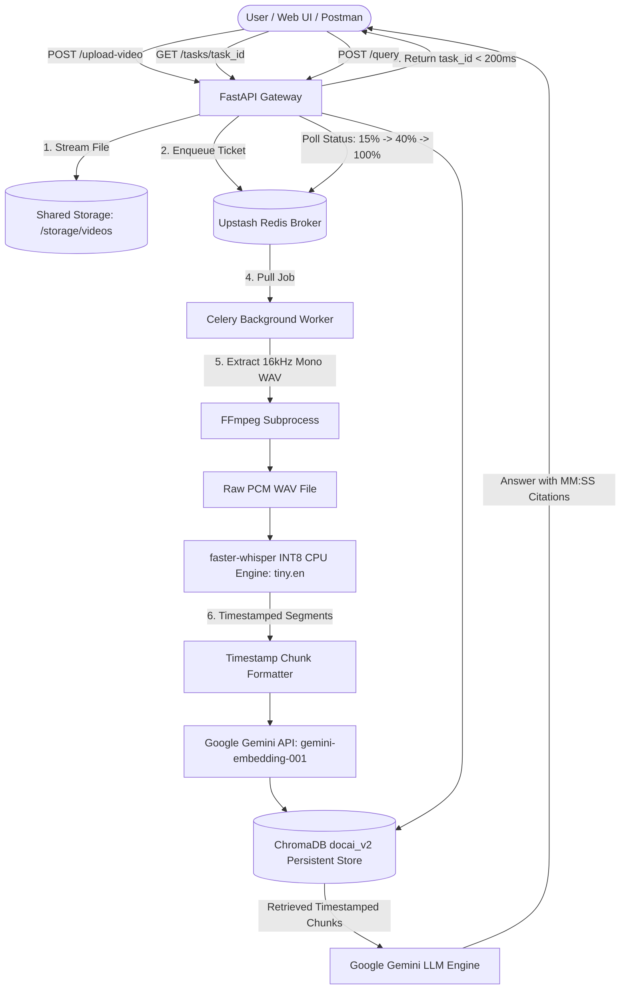

# ⚡ DocAI & Video Intelligence Engine — Asynchronous RAG Pipeline

[](https://fastapi.tiangolo.com)
[](https://docs.celeryq.dev/)
[](https://redis.io/)
[](https://www.docker.com/)
[](https://ai.google.dev/)
[](https://www.trychroma.com/)
[](https://github.com/openai/whisper)

A **Multimodal Retrieval-Augmented Generation (RAG) Engine** built to run entirely on free-tier infrastructure, capable of processing PDF/DOCX documents as well as video uploads (`.mp4`, `.mkv`, `.webm`) — **capped at 2:30 on Render Free, with every limit measured rather than assumed; see [Free-Tier Limits](#-free-tier-limits--what-video-lengths-actually-work)**. 

Features an asynchronous event-driven worker queue (**Redis + Celery**), **FFmpeg** audio extraction, **INT8 quantized faster-whisper** transcription, **Google Gemini 768-dim embeddings**, persistent **ChromaDB** vector storage, and **Gemini Flash** temporal citation Q&A (`[MM:SS]`).

---

## 🌟 Key Architectural & Engineering Highlights

### 1. 🚀 Asynchronous Video Processing (Producer-Consumer Pattern)
Heavy video processing runs outside the request path so the API stays responsive while a job is queued:
- **FastAPI Gateway (Producer)**: Accepts video uploads via chunked streaming (`shutil.copyfileobj`), writes to shared storage, and enqueues a lightweight JSON ticket to Redis in **$<200\text{ms}$**.
- **Redis Message Broker**: Manages queued jobs and stores task state metadata.
- **Celery Worker Pool (Consumer)**: Isolated background worker process that consumes tickets, executes FFmpeg audio extraction, runs Whisper transcription, and handles vector indexing.

The isolation is by *process*, not by machine: `start.sh` runs the gateway and the worker inside one container, so they still share a single memory budget — which is what actually bounds video length (see [Free-Tier Limits](#-free-tier-limits--what-video-lengths-actually-work)). "Microservice" in this deployed demo means decoupled processes and queues, not separate physical host instances.

### 2. 🎧 16kHz Mono Audio Extraction via FFmpeg Subprocess
Invokes an uncompressed PCM 16-bit WAV conversion (`-ar 16000 -ac 1 -vn`) via Python `subprocess`. Converting stereo/48kHz audio to 16kHz mono cuts raw audio data size by **50%** and eliminates CPU decoding overhead for the AI model.

### 3. 🧠 INT8 Quantized Local Speech Recognition (`faster-whisper`)
Utilizes `faster-whisper` on CTranslate2 CPU engine with **INT8 quantization**:
- English-only by default (`tiny.en` checkpoint); non-English audio is not supported unless `WHISPER_MODEL_SIZE` is overridden with a multilingual checkpoint.
- Published benchmarks report ~70% lower RAM and ~4x faster inference than vanilla PyTorch Whisper (unmeasured in this specific container; what *is* measured here is the container peak per upload — 304–388 MB on the runs that finished — reported by the app itself, with the model-load cost now broken out separately).
- Generates precise segment-level timestamps (`[01:15 - 01:45]`).
- Voice Activity Detection (VAD) filter is explicitly disabled (`vad_filter=False`) in code to avoid loading Silero's ~80 MB ONNX runtime into the memory-constrained container.

### 4. ☁️ Zero-RAM Cloud Vector Embeddings
Local embedding models (`all-MiniLM-L6-v2`) were completely replaced with **Google Gemini Embeddings (`gemini-embedding-001`, 768 dimensions)**. This eliminated ONNX Runtime and local neural net weights from the container, freeing ~160 MB of memory for Whisper inference.

### 5. ⏱️ Temporal Citation Prompt Engineering
Video transcript segments are indexed into ChromaDB with explicit inline timestamp markers. Gemini is governed by strict citation rules:
> *"At [04:12 - 04:35], the speaker explains B-Trees..."*
Allows users to scrub directly to the exact moment in the video.

### 6. 🐳 Container Topology (Docker Compose)
Orchestrates 3 isolated services locally over a private internal bridge network:
1. `rag_api_backend`: FastAPI Gateway
2. `rag_redis`: Redis 7 Broker
3. `rag_celery_worker`: Celery Worker with pre-cached Whisper models
Uses volume mounts (`./storage`, `./chroma_db`) for shared host disk access.

---

## 🏗️ Architecture Diagram



---

## 🛠️ Tech Stack

| Component | Technology | Purpose |
| :--- | :--- | :--- |
| **API Gateway** | **FastAPI** | High-performance asynchronous REST routing & streaming |
| **Task Queue & Broker** | **Redis** | Cloud message broker (Upstash) with SSL certificate validation |
| **Distributed Worker** | **Celery** | Isolated background process execution |
| **Media Processing** | **FFmpeg / ffprobe** | Binary subprocess audio extraction (16kHz mono WAV) |
| **Speech Recognition** | **faster-whisper** | INT8 CTranslate2 CPU model (`tiny.en`, single thread) |
| **Vector Database** | **ChromaDB** | Local persistent dense vector database (`docai_v2`) |
| **Embedding Engine** | **Google Gemini API** | Cloud-based `gemini-embedding-001` (768-dimensional) |
| **LLM Inference** | **Google GenAI SDK** | Resilient Gemini Flash citation engine |
| **Containerization** | **Docker & Docker Compose** | Multi-process container deployment via `start.sh` |

---

## 📡 API Endpoints

### 1. Video Ingestion & Polling

#### `POST /upload-video`
Streams video file to storage and enqueues background processing.
- **Form Data**: `file` (`.mp4`, `.mkv`, `.mov`, `.webm`, `.avi`)
- **Response ($<200\text{ms}$)**:
```json
{
  "status": "queued",
  "task_id": "39ca2ffe-f378-427a-8593-d8f986697780",
  "filename": "lecture.mp4",
  "check_status_url": "/tasks/39ca2ffe-f378-427a-8593-d8f986697780"
}
```

#### `GET /tasks/{task_id}`
Polls Celery background worker progress and container memory.
- **Response**:
```json
{
  "task_id": "39ca2ffe-f378-427a-8593-d8f986697780",
  "state": "PROCESSING",
  "progress": 45,
  "step": "Transcribing audio with Whisper",
  "container_memory": {
    "container_anon_mb": 284,
    "limit_mb": 512
  }
}
```

---

### 2. Temporal Citation Querying

#### `POST /query`
Queries indexed document and video knowledge base.
- **Body**:
```json
{
  "session_id": "session_123",
  "question": "When did the lecturer explain database indexing?"
}
```
- **Response**:
```json
{
  "answer": "At [04:15 - 04:45], the lecturer explains that database indexing uses B-Trees to minimize disk block reads...",
  "sources": [
    "[04:15 - 04:45] In this section, database indexing is introduced using B-Trees..."
  ]
}
```

---

## 🚀 Quickstart (Docker Compose)

### Prerequisites
- [Docker Desktop](https://www.docker.com/products/docker-desktop/) installed & running.
- A [Google AI Studio Gemini API Key](https://aistudio.google.com/).

### 1. Clone & Configure
```bash
git clone https://github.com/farzeen-code/distributed-video-rag-engine.git
cd distributed-video-rag-engine

# Create .env file
echo "GEMINI_API_KEY=your_gemini_api_key_here" > .env
```

### 2. Boot the Cluster
```bash
docker compose up --build
```

Access the interactive API documentation at: **`http://localhost:8000/docs`**

---

## ⚖️ Free-Tier Limits — What Video Lengths Actually Work

Video ingestion is bounded by RAM, not by code. `start.sh` runs the FastAPI gateway and the Celery worker as **two Python processes inside one container**, so they share Render Free's single **512 MB** budget, and its **0.1 vCPU** sets the transcription speed (~10 minutes of wall clock for a 4-minute clip).

Every figure below is the container's cgroup reading (`memory.stat` `anon` against `memory.max`), reported by the app itself at the end of each upload — not a per-process RSS estimate and not a model.

| Clip | Outcome on Render Free | Peak container memory |
| --- | --- | --- |
| 2:20 | indexed | 324 MB |
| 2:54 | indexed, then **killed on a rerun minutes later** | 357 MB on the run that survived; the run that died had a last reading of 344 MB |
| 2:57 | indexed | 388 MB |
| 3:47 | indexed, **twice** | 304 MB and 356 MB |
| 4:18 | **killed mid-decode** | kernel got it before the guard did |
| 5:25 | refused before upload | — |
| 5:40 | killed mid-decode, twice | 463 MB observed 21s into decoding, then a restart |

**The 2:54 row is the whole finding.** Same file, same build, minutes apart: one upload finished at 357 MB, the next was SIGKILLed after a heartbeat reading of 344 MB. Clip length cannot explain that, and neither can `tmpfs` (`container_shmem_mb` reads 0; the gap between the container total and `anon` is reclaimable page cache) nor the decoded audio itself (~11 MB for 2:54). What it isolates is a **single uninterruptible allocation**: `model.transcribe()` decodes the whole file and builds its features before it yields its first segment, no heartbeat and no abort flag can run inside that stretch, and the container that died had **168 MB free** when it entered it. So that step is now measured to need *more than 168 MB* — and **what it is, still isn't known.** Four formulas were fitted to these peaks during development and all four were falsified by the next upload, so the number below is a lower bound from one kill, not a distribution.

That reframes the question. Whether an upload survives is not "is this clip short enough" but "how full was the shared container at the second the worker started decoding" — and unlike clip length, that is observable at the moment of decision. `WHISPER_PREYIELD_SPIKE_MB` (170) is the free-memory floor the worker checks immediately before the uninterruptible step: **a cold container takes the clip, a warm one refuses it before decoding a byte**, with an error that says which. The same 2:54 file is therefore accepted or refused depending on the container, which is the point.

The length clamp stays as the outer bound, but it is a **risk choice, not a verified safe length**. `MAX_VERIFIED_VIDEO_SECONDS=150` (2:30) sits below the shortest run that has ever died; that is its entire justification, and 388 MB of a 512 MB budget has already been reached by a *success*.

What enforces it, cheapest failure first:

1. **In the browser**, before the file leaves disk: the frontend reads `worker.max_video_seconds` from `GET /` and refuses over-length uploads outright.
2. **In the worker**, after audio extraction: `MAX_VERIFIED_VIDEO_SECONDS` clamps the cap, and an affordability check refuses when the memory the gateway currently holds plus the Whisper load would exceed the container. Raising `MAX_VIDEO_SECONDS` in the dashboard cannot bypass either.
3. **Immediately before decoding**, once the weights are resident: the worker compares the container's free memory against the measured pre-yield spike and refuses as a readable error if the headroom is smaller. This is the guard that covers the window nothing else can interrupt.
4. **Mid-decode**, a tripwire aborts the task at 440 MB of 512 MB as a readable error instead of waiting for the kernel's SIGKILL — which used to mean a Render OOM email and a progress bar frozen at 45% forever.
5. **After a kill**, the gateway notices that the task's last heartbeat predates its own boot, and reports *"Killed mid-task at 45% (…): the worker's last reading before the restart was XMB heap / YMB total of 512MB"*. The number travels inside the Celery heartbeat itself — an earlier version wrote it to a separate Redis key and then to a local file, and both silently failed to report the exact runs they existed to measure.

**Known gap:** step 3 refuses *before* the pre-yield step; it still cannot stop one already in progress, and step 4 cannot reach inside it either. What changed is that the entry condition is now checked against a measured number, and the reading from the last moment before the window survives the death (step 5) — which is how the 168 MB above was obtained.

`GET /` exposes the whole breakdown (`api_memory`: `container_anon_mb`, `container_shmem_mb`, `cgroup_gap_mb`, `limit_mb`) and the upload progress line shows the live figure, so this is all measurable without shell access or log filtering.

**Indexed is not the same as fully transcribed.** The worker compares the last segment's timestamp against the audio length and reports `transcript_coverage_percent`, which the upload toast shows as *"warning: only X% of the audio was transcribed"* when it falls under 80%. Judge a clip near the ceiling by that number, not by a green progress bar.

PDF and DOCX ingestion is unaffected — no FFmpeg, no Whisper, parsed in the request path.

The ceiling is a single deployment variable, reported live: `GET /` returns `worker.max_video_seconds`, and the frontend reads it when the upload drawer opens, so changing `MAX_VERIFIED_VIDEO_SECONDS` in the Render dashboard takes effect without touching frontend code. Transcription speed is the other bound — a 4-minute clip takes ~10 minutes of wall clock on 0.1 vCPU, and `CELERY_TASK_SOFT_TIME_LIMIT` (default 1800s) fails a task cleanly long before it can spin forever, so raise both together. The honest reading of the table above is that **this tier has no defensible length limit at all** — the shortest upload that has ever died was under 3 minutes — so the cap is a bet on variance rather than a boundary. What is *not* a bet: the same image runs unchanged on a machine with a real CPU and 2 GB+ RAM (`docker compose up --build`), where the length limit stops being interesting — noting that `chroma_db/` is a local persistent store, so that is a different index, not the deployed one.

---

## 📄 License
Distributed under the MIT License.
