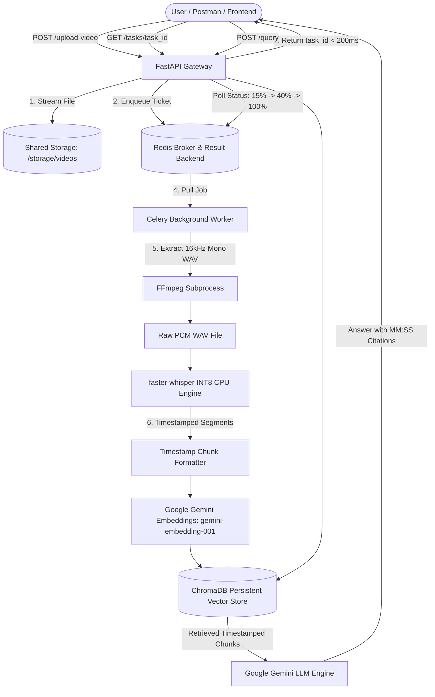

# ⚡ DocAI & Video Intelligence Engine — Distributed Asynchronous RAG Pipeline

[](https://fastapi.tiangolo.com)
[](https://docs.celeryq.dev/)
[](https://redis.io/)
[](https://www.docker.com/)
[](https://ai.google.dev/)
[](https://www.trychroma.com/)
[](https://github.com/openai/whisper)

A **Multimodal Retrieval-Augmented Generation (RAG) Engine** built to run entirely on free-tier infrastructure, capable of processing large PDF/DOCX documents as well as video uploads (`.mp4`, `.mkv`, `.webm`) — **up to 3:30 on Render Free, with every limit measured rather than assumed; see [Free-Tier Limits](#-free-tier-limits--what-video-lengths-actually-work)**. Features an asynchronous event-driven worker queue (**Redis + Celery**), **FFmpeg** audio extraction, **INT8 quantized Whisper** speech-to-text transcription, **ChromaDB** vector storage, and **Gemini** temporal citation Q&A (`[MM:SS]`).

---

## 🌟 Key Architectural & Engineering Highlights

### 1. 🚀 Asynchronous Distributed Video Processing (Producer-Consumer Pattern)
Heavy video processing runs outside the request path so the API stays responsive while a job is queued:
- **FastAPI Gateway (Producer)**: Accepts video uploads via chunked streaming (`shutil.copyfileobj`), writes to shared storage, and enqueues a lightweight JSON ticket to Redis in **$<200\text{ms}$**.
- **Redis Message Broker**: Manages queued jobs and stores task state metadata.
- **Celery Worker Pool (Consumer)**: Isolated background worker process that consumes tickets, executes FFmpeg audio extraction, and runs Whisper transcription without blocking web traffic.

The isolation is by *process*, not by machine: `start.sh` runs the gateway and the worker inside one container, so they still share a single memory budget — which is what actually bounds video length (see [Free-Tier Limits](#-free-tier-limits--what-video-lengths-actually-work)).

### 2. 🎧 16kHz Mono Audio Extraction via FFmpeg Subprocess
Invokes an uncompressed PCM 16-bit WAV conversion (`-ar 16000 -ac 1 -vn`) via Python `subprocess`. Converting stereo/48kHz audio to 16kHz mono cuts raw audio data size by **50%** and eliminates CPU decoding overhead for the AI model.

### 3. 🧠 INT8 Quantized Local Speech Recognition (`faster-whisper`)
Utilizes `faster-whisper` on CTranslate2 CPU engine with **INT8 quantization**:
- INT8 was picked for the memory envelope, not from a benchmark: this container has 512 MB shared with the API. Measured here — loading `tiny.en` costs **~130-150 MB** of non-reclaimable memory, and a 3:47 clip peaks at **356 MB**. The widely quoted ~70% RAM / 4x speed figures versus vanilla PyTorch Whisper were **never measured on this stack** and are not claimed as results.
- Auto-detect is wired up (`language=None`), but the shipped checkpoint is **`tiny.en`, an English-only model** — "99 languages" belongs to the multilingual checkpoints. Non-English audio needs a different `WHISPER_MODEL_SIZE`, and setting `WHISPER_LANGUAGE` skips the detection pass entirely.
- Generates precise segment-level timestamps (`[01:15 - 01:45]`).

### 4. ⏱️ Temporal Citation Prompt Engineering
Video transcript segments are indexed into ChromaDB with explicit inline timestamp markers. Gemini is governed by strict citation rules:
> *"At [04:12 - 04:35], the speaker explains B-Trees..."*
Allows users to scrub directly to the exact moment in the video.

### 5. 🐳 Container Topology (Docker Compose)
Locally this is 3 containers over a private internal bridge network:
1. `rag_api_backend`: FastAPI Gateway
2. `rag_redis`: Redis 7 Broker
3. `rag_celery_worker`: Celery Worker with pre-cached Whisper & Chroma models
Uses volume mounts (`./storage`, `./chroma_db`) for shared host disk access.

On Render Free the same image runs **one** container whose `start.sh` starts the gateway and the worker as two processes, because the tier has no free worker instance — so they share one 512 MB cgroup, which is the constraint the whole [Free-Tier Limits](#-free-tier-limits--what-video-lengths-actually-work) section is about. "Microservice" here means decoupled *processes and queues*, not separately scheduled machines.

---

## 🏗️ Architecture Diagram



---

## 🛠️ Tech Stack

| Component | Technology | Purpose |
| :--- | :--- | :--- |
| **API Gateway** | **FastAPI** | High-performance asynchronous REST routing & streaming |
| **Task Queue & Broker** | **Redis** | In-memory message broker & task state store |
| **Distributed Worker** | **Celery** | Isolated background process execution |
| **Media Processing** | **FFmpeg** | Binary subprocess audio extraction (16kHz mono WAV) |
| **Speech Recognition** | **faster-whisper** | INT8 CTranslate2 CPU model for timestamped transcription |
| **Vector Database** | **ChromaDB** | Local persistent dense vector database |
| **Embedding Model** | **Google Gemini** | Cloud-based `gemini-embedding-001` (768 dimensions), called from `embeddings.py` |
| **LLM Inference** | **Google GenAI SDK** | Resilient Gemini Flash-Lite citation engine |
| **Containerization** | **Docker & Docker Compose** | 3 services locally; Render Free runs gateway + worker as 2 processes in 1 container |

---

## 📡 API Endpoints

### 1. Video Ingestion & Polling

#### `POST /upload-video`
Streams video file to storage and enqueues background processing.
- **Form Data**: `file` (`.mp4`, `.mkv`, `.mov`, `.webm`, `.avi`)
- **Response ($<200\text{ms}$)**:
```json
{
  "status": "queued",
  "task_id": "39ca2ffe-f378-427a-8593-d8f986697780",
  "filename": "lecture.mp4",
  "check_status_url": "/tasks/39ca2ffe-f378-427a-8593-d8f986697780"
}
```

#### `GET /tasks/{task_id}`
Polls Celery background worker progress.
- **Response**:
```json
{
  "task_id": "39ca2ffe-f378-427a-8593-d8f986697780",
  "state": "PROCESSING",
  "progress": 40,
  "step": "Transcribing audio with Whisper"
}
```

---

### 2. Temporal Citation Querying

#### `POST /query`
Queries indexed document and video knowledge base.
- **Body**:
```json
{
  "session_id": "session_123",
  "question": "When did the lecturer explain database indexing?"
}
```
- **Response**:
```json
{
  "answer": "At [04:15 - 04:45], the lecturer explains that database indexing uses B-Trees to minimize disk block reads...",
  "sources": [
    "[04:15 - 04:45] In this section, database indexing is introduced using B-Trees..."
  ]
}
```

---

## 🚀 Quickstart (Single Command)

### Prerequisites
- [Docker Desktop](https://www.docker.com/products/docker-desktop/) installed & running.
- A [Google AI Studio Gemini API Key](https://aistudio.google.com/).

### 1. Clone & Configure
```bash
git clone https://github.com/YOUR_USERNAME/distributed-video-rag-engine.git
cd distributed-video-rag-engine

# Create .env file
echo "GEMINI_API_KEY=your_gemini_api_key_here" > .env
```

### 2. Boot the Cluster
```bash
docker compose up --build
```

Access the interactive API documentation at: **`http://localhost:8000/docs`**

---

## ⚖️ Free-Tier Limits — What Video Lengths Actually Work

Video ingestion is bounded by RAM, not by code. `start.sh` runs the FastAPI gateway and the Celery worker as **two Python processes inside one container**, so they share Render Free's single **512 MB** budget, and its **0.1 vCPU** sets the transcription speed (~10 minutes of wall clock for a 4-minute clip).

Every figure below is the container's cgroup reading (`memory.stat` `anon` against `memory.max`), reported by the app itself at the end of each upload — not a per-process RSS estimate and not a model.

| Clip | Outcome on Render Free | Peak container memory |
| --- | --- | --- |
| 2:20 | indexed | 324 MB |
| 3:47 | indexed, twice | 304 MB and 356 MB |
| 4:18 | **killed mid-decode** | the kernel got it before the guard did |
| 5:25 | refused before upload | — |
| 5:40 | killed mid-decode, twice | 463 MB observed 21s into decoding, then a restart |

**Duration is a proxy for memory, not a predictor.** The same 3:47 clip peaked 52 MB apart across two runs, and `tmpfs` is not the explanation (`container_shmem_mb` reads 0 — the gap between the container total and `anon` is reclaimable page cache). What moves the baseline is what the gateway is already holding when the worker starts: a container that has just served ChromaDB queries has less room than a freshly woken one. Three different formulas were fitted to these peaks during development and all three were falsified by the next upload, so the enforced ceiling is an **empirical clamp, not an extrapolation**.

So the cap is deliberately below the longest verified run. `MAX_VERIFIED_VIDEO_SECONDS=210` (3:30) sits one notch under the 3:47 that works twice, because a visitor's crash costs more than the last twenty seconds of a clip.

What enforces it, cheapest failure first:

1. **In the browser**, before the file leaves disk: the frontend reads `worker.max_video_seconds` from `GET /` and refuses over-length uploads outright.
2. **In the worker**, after audio extraction: `MAX_VERIFIED_VIDEO_SECONDS` clamps the cap, and an affordability check refuses when the memory the gateway currently holds plus the Whisper load would exceed the container. Raising `MAX_VIDEO_SECONDS` in the dashboard cannot bypass either.
3. **Mid-decode**, a tripwire aborts the task at 440 MB of 512 MB as a readable error instead of waiting for the kernel's SIGKILL — which used to mean a Render OOM email and a progress bar frozen at 45% forever.
4. **After a kill**, the gateway notices that the task's last heartbeat predates its own boot, and reports *"Killed mid-task at 45%: the worker's last reading before the restart was XMB"*. That last reading is written to Redis while the task runs, because Render wipes an instance's local files on restart.

Known gap: step 3 cannot fire inside `model.transcribe()`'s pre-yield work, where no heartbeat runs, which is where both observed kills happened. Step 4 exists because step 3 can't reach it.

`GET /` exposes the whole breakdown (`api_memory`: `container_anon_mb`, `container_shmem_mb`, `cgroup_gap_mb`, `limit_mb`) and the upload progress line shows the live figure, so this is all measurable without shell access or log filtering.

**Indexed is not the same as fully transcribed.** The worker compares the last segment's timestamp against the audio length and reports `transcript_coverage_percent`, which the upload toast shows as *"warning: only X% of the audio was transcribed"* when it falls under 80%. Judge a clip near the ceiling by that number, not by a green progress bar.

PDF and DOCX ingestion is unaffected — no FFmpeg, no Whisper, parsed in the request path.

The ceiling is a single deployment variable, reported live: `GET /` returns `worker.max_video_seconds`, and the frontend reads it when the upload drawer opens, so changing `MAX_VERIFIED_VIDEO_SECONDS` in the Render dashboard takes effect without touching frontend code. Transcription speed is the other bound — `CELERY_TASK_SOFT_TIME_LIMIT` (default 1800s) fails a task cleanly long before it can spin forever, so raise both together. Beyond roughly 4 minutes on this tier, the honest answer is that free CPU and 512 MB cannot fit a full-text stack plus local Whisper inference in one container; the same image runs unchanged on a machine with a real CPU and 2 GB+ RAM (`docker compose up --build`), where the length limit stops being interesting — noting that `chroma_db/` is a local persistent store, so that is a different index, not the deployed one.

---

## 📄 License
Distributed under the MIT License.
